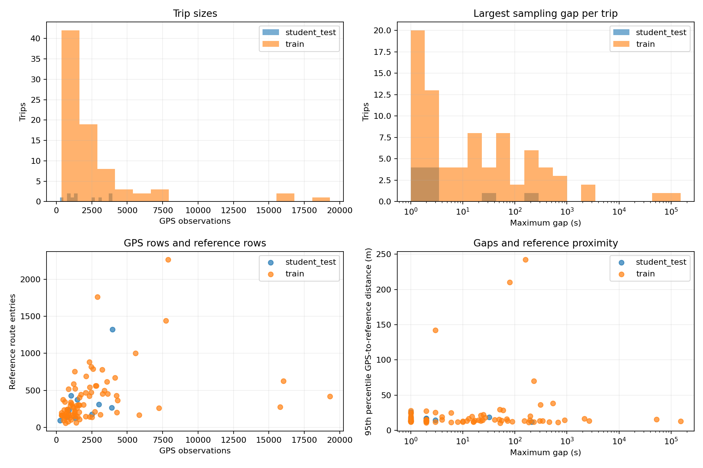
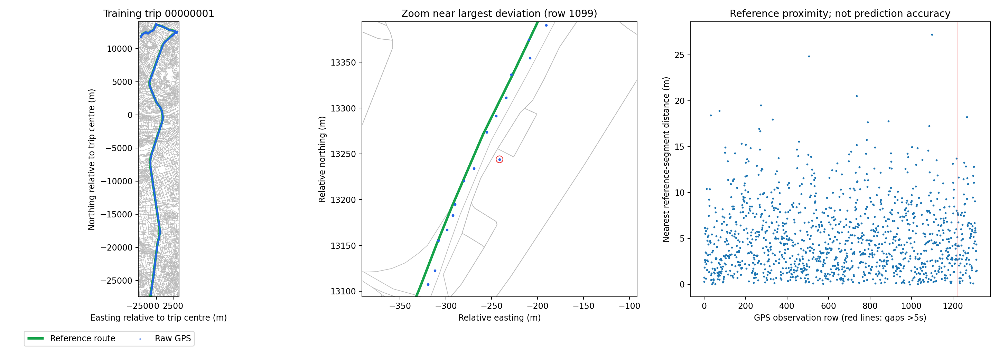
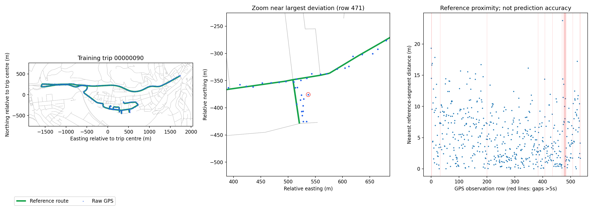
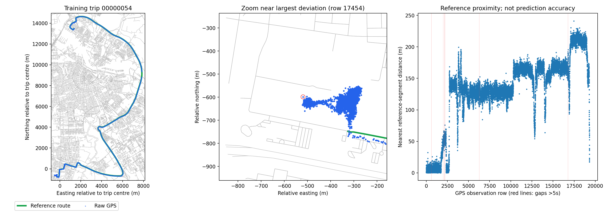

# Dataset audit and exploratory visual inspection

Scope: development data only (`train` and `student_test`). No evaluator-testing data was inspected. This is a reproducible EDA record for the technical report, not a claim of model performance.

## Reproduce

```powershell
python -m pip install -r requirements.txt
python experiments/01_dataset_exploration.py
```

The audit is read-only: no GPS samples, graph rows or reference labels are modified. Malformed rows fail the trip rather than silently renumbering row-based IDs. Expected file widths, finite values, coordinate ranges and integer ID bounds are checked.

## Partition inventory

| Partition | Trips | GPS observations | Reference entries | GPS rows per trip (min / median / max) |
|---|---:|---:|---:|---|
| student_test | 10 | 19,160 | 3,477 | 262 / 1420 / 3958 |
| train | 80 | 208,417 | 31,336 | 361 / 1529 / 19313 |

Node and arc counts in the CSV are per trip; their sums must not be interpreted as unique physical roads. Exact coordinate/connectivity hashing found 90 distinct supplied graph representations.

## Measured quality findings

### student_test

- Invalid GPS/node/arc/route rows: 0 / 0 / 0 / 0.
- Exact duplicate GPS rows: 0; nonpositive timestamp steps: 0.
- Exactly 1-second steps: 18,886/19,150 (98.62%). Gaps above 1 second: 264; above 5 seconds: 44; maximum gap: 210 seconds.
- Steps with implied speed above 55 m/s (198 km/h): 4. This is a diagnostic flag, not an automatic removal rule.
- Reference consecutive pairs that do not share the directed endpoint: 1.
- GPS observations farther than 50 m from every reference segment: 27. Distances use the nearest segment anywhere on the reference route, without temporal alignment.
- Weak components per supplied graph: 5–100; strong components: 6–415; isolated nodes: 0–0.

### train

- Invalid GPS/node/arc/route rows: 0 / 0 / 0 / 0.
- Exact duplicate GPS rows: 0; nonpositive timestamp steps: 0.
- Exactly 1-second steps: 201,048/208,337 (96.50%). Gaps above 1 second: 7,286; above 5 seconds: 1,216; maximum gap: 153064 seconds.
- Steps with implied speed above 55 m/s (198 km/h): 989. This is a diagnostic flag, not an automatic removal rule.
- Reference consecutive pairs that do not share the directed endpoint: 13.
- GPS observations farther than 50 m from every reference segment: 22,576. Distances use the nearest segment anywhere on the reference route, without temporal alignment.
- Weak components per supplied graph: 1–421; strong components: 2–1942; isolated nodes: 0–0.

## Figures and maps



### Training trip 00000001



[Interactive Folium map](../maps/audit/train_00000001.html)

### Training trip 00000090



[Interactive Folium map](../maps/audit/train_00000090.html)

### Training trip 00000054



[Interactive Folium map](../maps/audit/train_00000054.html)

Selection is deterministic: the first training trip, the training trip with the largest sampling gap, and the training trip with the most observations above 50 m from the reference (deduplicated if identical). Maps contain raw GPS, local road geometry, reference route, start/end markers and gaps above 5 seconds. Dashed gap connectors do not establish the actual travelled path. No predicted-route layer is available at this stage. Folium maps require internet access for CDN scripts and base tiles; the PNG figures work offline.

## Preprocessing and feature decisions

- Preserve original row indices: node IDs and arc IDs are zero-based row positions within each trip.
- Treat IDs as local to each trip/network. An arc ID is not a globally reusable road class. The supplied trips span multiple geographical regions.
- Preserve raw observations. Flag duplicates, jumps and gaps before deciding on any cleaning policy.
- Use per-trip WGS84 UTM coordinates for metric geometry, with longitude-first transformations. EPSG codes are saved in the inventory. Check that a trip is local to its chosen zone before reusing this projection for future datasets.
- Keep arc direction as supplied. Weak connectivity describes physical reachability ignoring direction; strong connectivity describes directed reachability.
- Reference distance is an EDA diagnostic only. It must never be an inference feature, because reference routes are unavailable to the prediction pipeline.
- Candidate generation, speed/heading features, scaling, imputation and pointwise label generation are not implemented by this audit.
- Future cross-validation must group by trip. Any learned preprocessing must be fitted within each training fold. Student-testing data is permitted for development comparison; evaluator-testing data remains reserved.

## Label alignment limitation

The reference file records an ordered arc traversal sequence, while the track records timed GPS observations. These are different units and cannot be joined by row number. A vehicle may produce many GPS observations on one arc, and may traverse multiple arcs between observations. Repeated route arcs also require preserving traversal order. A separate, documented, order-aware reference-alignment method is needed before supervised pointwise training and evaluation. Any derived labels are reference-derived estimates, not independently measured pointwise truth. Nearest-reference distances do not solve that alignment and are not classification accuracy.

## Saved evidence

- `results/audit/trip_inventory.csv`: per-trip schema, counts, timestamps, geometry, graph and reference checks.
- `results/audit/anomalies.csv`: trips with the documented diagnostic flags.
- `results/audit/events.csv`: GPS gap row pairs and broken reference endpoint pairs, with original zero-based row indices.
- `results/audit/environment.json`: Python and package versions used for this run.
- `results/audit/summary.json`: partition totals and parsing failures.
- `results/audit/*.png`: reproducible static figures.
- `maps/audit/*.html`: interactive Folium development maps.

Source requirements: Dataset Exploration.pdf (sections 3–9), Deliverables.pdf (dataset/EDA section and Folium requirements), and Models and Training Guidelines.pdf (group-aware validation and observation-level evaluation). Original PDFs remain in the sibling PathSnap_student_materials folder.
